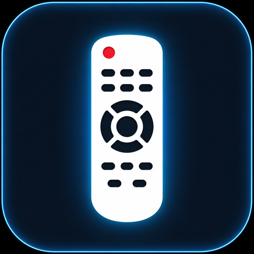
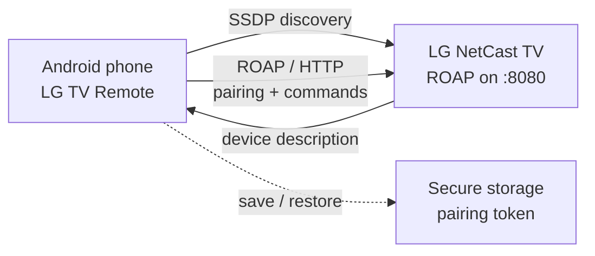

<p align="center">
  
</p>

<h1 align="center">LG TV Remote</h1>

<p align="center">
  <strong>LG TV Remote</strong> turns your Android phone into a fast, private remote for LG NetCast 3.0 and 4.0 TVs.
</p>

<p align="center">
  Same Wi-Fi, automatic discovery, one-time pairing.<br>
  No cloud, no account, no ads, no telemetry.
</p>

<p align="center">
  <a href="https://github.com/cmtrkr83/LG-TV-Kumandasi/releases/latest"></a>
  <a href="https://github.com/cmtrkr83/LG-TV-Kumandasi/releases/latest/download/netcast-remote.apk"></a>
  <a href="#supported-tvs"></a>
  <a href="LICENSE"></a>
  <a href="https://www.buymeacoffee.com/cmtrkr"></a>
</p>

<p align="center">
  <a href="https://github.com/cmtrkr83/LG-TV-Kumandasi/releases/latest/download/netcast-remote.apk"></a>
  <a href="#build-from-source"></a>
</p>

**LG TV Remote** is an open-source Android app for controlling older LG smart TVs over the local network. It speaks the **LG NetCast ROAP** protocol directly, discovers TVs with **SSDP**, and keeps working without a cloud service in the middle.

The app is called **NetCast Kumanda** on your phone. It is built for LG NetCast 3.0 and 4.0 televisions, the generations that use the ROAP HTTP/XML API on port 8080.

## Highlights

- **Automatic discovery.** Finds LG NetCast TVs on your Wi-Fi with SSDP, plus a bounded subnet scan when multicast is unavailable.
- **Manual fallback.** Type the TV's IP address and pair with the 6-digit code shown on screen.
- **One-time pairing.** The access token is stored in the device's secure storage and restored on the next launch.
- **Silent reconnect.** If the TV's IP changes, the app looks for the same TV again. If the TV is offline, the remote stays open with a quiet status instead of a blocking error.
- **Full remote control.** Power, volume, channel, direction pad, OK, back, home, menu, exit, info, guide, quick menu, input, apps, media transport, and the four colour keys.
- **Real touchpad.** Drag to move the pointer, tap to click, and use dedicated scroll buttons.
- **Three tabs.** Touchpad, Remote, and Numbers, so the most-used keys are always one thumb away.
- **Turkish and English.** Opens in Turkish by default; switch to English instantly, and the choice is remembered.
- **Private by design.** The phone talks to your TV on your LAN. No analytics, advertising SDKs, accounts, or telemetry.

## Supported TVs

| Television | Support |
| --- | --- |
| LG NetCast 3.0 (ROAP) | Yes |
| LG NetCast 4.0 (ROAP) | Yes |
| LG webOS TVs | No, they use a different protocol |
| LG models before 2012 (HDCP) | No |

The app looks for the TV's ROAP service on port **8080** and accepts SSDP responses that identify themselves with `udap:rootservice`, `/udap/api/`, or a model code. See [docs/netcast-protocol.md](docs/netcast-protocol.md) for the compatibility boundary and command details.

## Install

### Android

1. **[Download the latest APK](https://github.com/cmtrkr83/LG-TV-Kumandasi/releases/latest/download/netcast-remote.apk)** (latest release).
2. Open the file on your phone. If Android asks, allow installs from your browser or file manager.
3. Connect the phone and the TV to the **same Wi-Fi network**.
4. Open **NetCast Kumanda**. Tap **Scan for TVs**, choose your TV, then tap **Request code from TV**.
5. Enter the **6-digit pairing code** shown on the television. The remote opens when pairing succeeds.

The Android package is `com.cmtrkr83.netcastremote`. The APK is distributed through [GitHub Releases](https://github.com/cmtrkr83/LG-TV-Kumandasi/releases).

### If the TV is not discovered

Tap the manual section, enter the TV's IP address (usually found under **Settings → Network** on the TV), and request a pairing code. Discovery needs a native build on a physical device; it does not work in a browser or in standard Expo Go.

## Using the remote

| Tab | What it gives you |
| --- | --- |
| **Touchpad** | Drag to move the on-screen pointer, tap to click, and use the scroll up/down buttons. |
| **Remote** | Power, input, apps, quick menu, guide, info, exit, volume, channel, D-pad, OK, back, home, menu, media controls, and colour keys. |
| **Numbers** | Number pad, dash, favourite, previous channel, channel list, and guide shortcuts. |

When you reopen the app, a saved TV is restored in the background. Buttons stay visible while the session is refreshed; you are not sent back to the setup screen unless the pairing is genuinely invalid.

## How it works



1. The app sends an SSDP M-SEARCH on the local network and probes candidates over HTTP.
2. It requests a pairing code from the TV and exchanges it for an access token.
3. Commands and touchpad events go directly to the TV as ROAP HTTP requests on port 8080.
4. The token is kept in secure storage, so later launches can create a session without asking for the code again.

NetCast uses cleartext HTTP on the local network, so the Android build enables `usesCleartextTraffic`. No third-party service sits between the phone and the TV.

## Build from source

### Requirements

- Node.js **>= 24.3.0**
- pnpm **12.6.0** (enable it with `corepack enable`)
- For a native Android development build: Android Studio and the Android SDK, or an Expo EAS account
- A physical phone for SSDP discovery; emulators and browsers exercise only the manual-IP path

### Setup

```bash
git clone https://github.com/cmtrkr83/LG-TV-Kumandasi.git
cd LG-TV-Kumandasi
corepack enable
pnpm install --frozen-lockfile
pnpm run verify
```

### Run the app

```bash
# Metro / Expo development server
pnpm --filter @workspace/netcast-remote run dev

# Native development build with the SSDP module
cd artifacts/netcast-remote
pnpm exec expo run:android
```

Build a preview APK with EAS:

```bash
cd artifacts/netcast-remote
npx eas-cli build --platform android --profile preview
```

The API server and component sandbox are optional workspace tools:

```bash
PORT=5000 pnpm --filter @workspace/api-server run dev
pnpm --filter @workspace/mockup-sandbox run dev
```

### Useful commands

| Command | Purpose |
| --- | --- |
| `pnpm run verify` | Codegen diff check, typecheck, tests, lint, and formatting |
| `pnpm run test` | Run the Vitest suite |
| `pnpm run typecheck` | Typecheck libraries, apps, scripts, and tests |
| `pnpm run lint` | Run ESLint |
| `pnpm run format:check` | Check Prettier formatting |
| `pnpm run build` | Build all workspace packages |
| `pnpm run doctor` | Run Expo Doctor for SDK version alignment |
| `pnpm run audit` | Audit dependencies at the moderate level |

### Environment variables

| Variable | Used for |
| --- | --- |
| `PUBLIC_ORIGIN` | Canonical origin for the static NetCast bundle; must not include a path, query, or fragment. CI uses `https://example.test`. |
| `BASE_PATH` | Safe absolute base path for the static bundle and mockup; defaults to `/`. |
| `DATABASE_URL` | PostgreSQL connection string for the API server and database workflow. |
| `PORT` | API server or mockup port; defaults are 5000 and 5173. |
| `EXPO_PUBLIC_DOMAIN` / `DEPLOYMENT_DOMAIN` | Fallback domain for the static NetCast build when `PUBLIC_ORIGIN` is absent. |

## Project layout

```text
artifacts/netcast-remote   Expo app: the remote itself (Android/iOS)
artifacts/api-server       Express 5 API (/api/healthz)
artifacts/mockup-sandbox   Vite component preview
lib/api-spec               OpenAPI spec + Orval generation
lib/api-client-react       Generated React Query client
lib/api-zod                Generated Zod schemas
lib/db                     Drizzle ORM schema and migrations
tests/                     Vitest suites for protocol, storage, i18n, CI checks
```

### Stack

| Layer | Technology |
| --- | --- |
| App | Expo 57, React Native 0.86, expo-router, TypeScript 6 |
| Discovery | `expo-ssdp` (SSDP M-SEARCH/B-SEARCH) + `expo-network` subnet fallback |
| TV protocol | LG NetCast ROAP, HTTP/XML on port 8080 |
| API | Express 5 |
| Database | PostgreSQL + Drizzle ORM |
| Contracts | OpenAPI, Zod, Orval |

## Testing and CI

The test suite covers the NetCast protocol, SSDP and subnet scanning, session restore, command availability, request queueing, secure storage, i18n, the static server, and layout edge cases.

```bash
pnpm run test
```

GitHub Actions runs two jobs on every push and pull request:

- **minimum-node-smoke** on Node 24.3.0: install, typecheck tests, and run tests.
- **verify** on Node 24.x: codegen diff, typecheck, tests, lint, format check, Expo Doctor, audit, and build.

## Troubleshooting

| Problem | What to try |
| --- | --- |
| The TV is not discovered | Confirm both devices are on the same Wi-Fi, disable client/AP isolation, and allow multicast. Use manual IP if the network blocks SSDP. |
| The pairing code is rejected | Request a fresh code from the TV; codes expire. Make sure the TV is awake and on the same network. |
| Buttons do nothing | Check the status in the TV card, wake the TV, and try reconnecting. Some keys are model-dependent. |
| The TV got a new IP | The app searches for the saved TV ID and updates the address; if it cannot find it, reconnect with the new IP. |
| Discovery fails on web/Expo Go | Raw SSDP needs a native development build on a physical device. Manual IP is the fallback. |

## Privacy

- No accounts, analytics, ads, or telemetry.
- Pairing tokens and connection details live in the platform secure store; the language preference is kept in AsyncStorage.
- The remote connects directly to the television over the local network.
- The optional API server in this repository is a development tool and is not required by the app.

## Limitations

- NetCast 3.0/4.0 only. LG webOS and pre-2012 HDCP models are out of scope.
- One saved TV at a time.
- No Wake-on-LAN or background service; the TV must be reachable.
- SSDP discovery requires a physical device and a native build.

## Contributing

Issues and pull requests are welcome. Before opening a PR, run:

```bash
pnpm run verify
```

Please keep changes covered by tests, especially around pairing, session restore, storage migration, and command handling.

## License

[MIT](LICENSE) © 2026 Cem Türker.

This project is independent. It is not affiliated with or endorsed by LG Electronics.

## Support

If this remote makes your TV easier to use, you can [buy me a coffee](https://www.buymeacoffee.com/cmtrkr).

[](https://www.buymeacoffee.com/cmtrkr)
